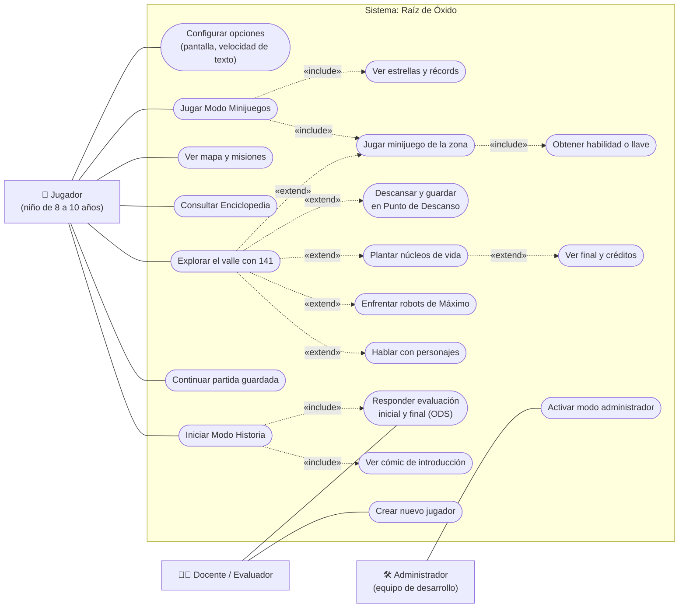
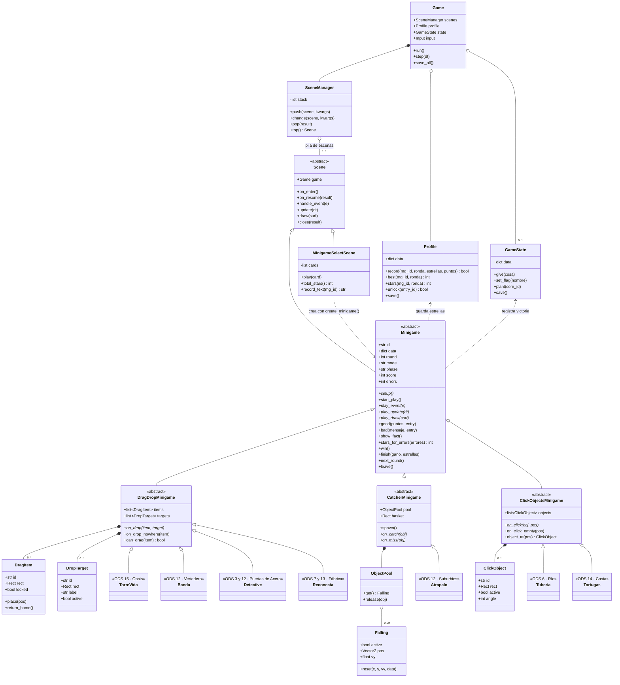

# Raíz de Óxido · Modelado UML

**Proyecto Integrador** · Introducción a la Ingeniería de Software  
Universidad de Colima, FIE · Grupo 1D  
Equipo: Ruiz García Osmar y Virgen Cervantes Hugo Alberto  
Profesor: Fernando Tomas Diaz Garcia

Esta carpeta contiene los dos diagramas UML que pide la actividad complementaria *"Modelando el Proyecto Integrador en UML"*:

1. El **diagrama de casos de uso general** del videojuego.
2. El **diagrama de clases del módulo de Minijuegos**, el módulo que le corresponde a nuestro equipo.

Ambos se basan en el Documento de Diseño del Juego (GDD) y en la arquitectura planeada en Python + pygame.

## Herramienta elegida: Mermaid

Elegimos **Mermaid** porque GitHub lo dibuja directamente en los archivos `.md`: el diagrama vive como texto dentro del repositorio, se puede revisar en cada *commit* y no hace falta instalar nada para verlo. También dejamos una imagen PNG y SVG de cada diagrama por si se quiere imprimir o pegar en una presentación.

## Contenido de la carpeta

| Archivo | Qué es |
|---|---|
| `README.md` | Este documento, con los dos diagramas y su explicación |
| `diagramas/casos_de_uso.mmd` | Código fuente Mermaid del diagrama de casos de uso |
| `diagramas/clases_minijuegos.mmd` | Código fuente Mermaid del diagrama de clases |
| `img/casos_de_uso.png` · `.svg` | Imagen exportada del diagrama de casos de uso |
| `img/clases_minijuegos.png` · `.svg` | Imagen exportada del diagrama de clases |

---

## 1. Diagrama de casos de uso general

Muestra **quién usa el sistema y qué puede hacer con él**, sin entrar en cómo está programado.

> Si el diagrama no se ve, abre [img/casos_de_uso.png](img/casos_de_uso.png).

### Actores

| Actor | Descripción |
|---|---|
| **Jugador** | Niño o niña de 8 a 10 años. Es el usuario principal: controla al robot *Proyecto 141* en el Modo Historia o juega libremente en el Modo Minijuegos. |
| **Docente / Evaluador** | Aplica el juego en el aula. Le interesa la evaluación inicial y final (para medir lo que el niño aprendió sobre los ODS) y crear un *nuevo jugador* cuando varios niños comparten la misma computadora. |
| **Administrador** | El equipo de desarrollo. Activa un modo oculto para probar el juego (saltar zonas, ver datos de depuración). |

### Casos de uso principales

- **Iniciar Modo Historia:** empieza la aventura completa. *Incluye* siempre el cómic de introducción y la evaluación inicial sobre medio ambiente (la final se responde al terminar).
- **Explorar el valle con 141:** es el corazón del juego. Mientras explora, el jugador *puede* (`«extend»`) hablar con personajes, enfrentar a los robots de Máximo, plantar núcleos de vida, descansar en un Punto de Descanso o jugar el minijuego de la zona.
- **Jugar minijuego de la zona:** cada una de las 7 zonas tiene un minijuego ligado a un ODS. Ganarlo *incluye* obtener una habilidad o llave que abre nuevas partes del mapa (progresión *metroidvania*).
- **Plantar núcleos de vida:** al plantar los núcleos principales se *extiende* hacia el final del juego y los créditos.
- **Jugar Modo Minijuegos:** permite jugar los 7 minijuegos sin la historia. *Incluye* jugar el minijuego y ver estrellas y récords.
- **Consultar Enciclopedia / Ver mapa y misiones / Configurar opciones:** herramientas de apoyo disponibles para el jugador.

### Notación

Mermaid no tiene un tipo de diagrama exclusivo para casos de uso, así que seguimos la convención UML con un diagrama de flujo: los **actores** son los rectángulos fuera del sistema, los **casos de uso** son las elipses dentro del recuadro *"Sistema: Raíz de Óxido"*, las **líneas sólidas** son asociaciones actor–caso de uso y las **flechas punteadas** son relaciones `«include»` (siempre ocurre) y `«extend»` (ocurre solo a veces).

---

## 2. Diagrama de clases del módulo de Minijuegos

El módulo de Minijuegos es donde el niño **aprende** sobre medio ambiente: cada minijuego enseña uno o más Objetivos de Desarrollo Sostenible. El diagrama muestra cómo se organiza el código de este módulo.

> Si el diagrama no se ve, abre [img/clases_minijuegos.png](img/clases_minijuegos.png).

### Cómo leerlo

**Clases del motor que usa el módulo (parte superior)**

- **Game:** el programa principal. Contiene el administrador de escenas (composición), el perfil del jugador y, solo en el Modo Historia, el estado de la partida (`0..1`).
- **SceneManager:** maneja una *pila de escenas*. Cuando empieza un minijuego se "apila" encima del mundo, y al terminar se quita y le regresa el resultado.
- **Scene:** clase abstracta de la que heredan todas las pantallas del juego (menú, mundo, minijuegos...).
- **Profile:** guarda las estrellas, los récords y las entradas desbloqueadas de la Enciclopedia. Lo usan los dos modos de juego.
- **GameState:** guarda la partida del Modo Historia. El minijuego registra ahí su victoria para entregar la recompensa.

**El núcleo del módulo**

- **Minigame** (abstracta) define el ciclo de vida que comparten los 7 minijuegos: pantalla de inicio → jugar → resultado. Ya trae resueltas las partes comunes: puntaje, errores, mensajes de acierto o error (`good`, `bad`), datos curiosos *"¿Sabías que...?"* (`show_fact`), cálculo de estrellas y el guardado del resultado (`finish`). Los métodos en *cursiva* son abstractos: cada minijuego los implementa a su manera.
- Hay **tres bases de mecánica**, también abstractas, que heredan de `Minigame`:
  - **DragDropMinigame:** arrastrar y soltar objetos (`DragItem`) sobre destinos (`DropTarget`).
  - **CatcherMinigame:** atrapar con una canasta objetos que caen (`Falling`). Usa un `ObjectPool` de hasta 24 objetos que se reciclan en lugar de crearse y borrarse, para que el juego no se trabe.
  - **ClickObjectsMinigame:** hacer clic sobre objetos de la pantalla (`ClickObject`).
- **Los 7 minijuegos concretos** heredan de la base que les toca. El estereotipo de cada uno indica el ODS que enseña y la zona del mapa donde aparece:

| Minijuego | Clase | Base | ODS | Zona |
|---|---|---|---|---|
| La Torre de la Vida | `TorreVida` | Arrastrar y soltar | 15 | El Oasis |
| ¡Atrápalo, sirve! | `Atrapalo` | Atrapar | 12 | Los Suburbios |
| Tubería Limpia | `Tuberia` | Clic | 6 | El Río |
| Rescate de Tortugas | `Tortugas` | Clic | 14 | La Costa |
| Banda Separadora | `Banda` | Arrastrar y soltar | 12 | El Vertedero |
| Detective de Peligros | `Detective` | Arrastrar y soltar | 3 y 12 | Puertas de Acero |
| Reconecta la Fábrica | `Reconecta` | Arrastrar y soltar | 7 y 13 | La Fábrica |

- **MinigameSelectScene** es la pantalla del Modo Minijuegos: muestra una tarjeta por minijuego con sus estrellas y crea el minijuego elegido mediante la función de fábrica `create_minigame()`.

### Decisiones de diseño que muestra el diagrama

- **Herencia en tres niveles** (`Scene` → `Minigame` → base de mecánica → minijuego): agregar un minijuego nuevo solo requiere escribir lo que lo hace diferente; todo lo demás ya funciona.
- **Datos separados del código:** las rondas, textos, datos curiosos y recompensas de cada minijuego están en archivos JSON (`data/minigames/`), así que se pueden ajustar sin tocar las clases.
- **Un mismo minijuego sirve para los dos modos:** el atributo `mode` (`"story"` o `"free"`) decide si al ganar se entrega una recompensa en la historia o solo se guarda el récord.

### Notación de relaciones

| Símbolo | Significado |
|---|---|
| Flecha con triángulo vacío | Herencia (*es un*) |
| Rombo relleno | Composición (la parte no existe sin el todo) |
| Rombo vacío | Agregación (el todo usa la parte, pero la parte puede existir sola) |
| Flecha punteada | Dependencia (una clase usa a otra) |
| `«abstract»` | Clase que no se usa directamente, solo se hereda |
| Texto en *cursiva* | Método abstracto que cada subclase debe implementar |
